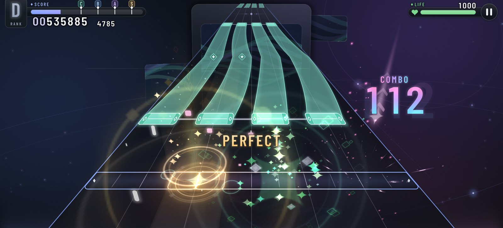

# 美术素材

打歌素材按[界面美术风格指南](../docs/reference/ui-style-guide.md)绘制。`Notes`、`NotesV2` 分别对应 custom01、custom02 两套音符皮肤。`HUD`、`Effects`、`Backgrounds` 分别存放界面、特效和背景。

NextRUSH 的 Damage 键身和节点沿用 Friction 的轮廓，使用紫色配色。生成器在 `Notes` 和 `NotesV2` 中分别输出 `notes_damage.png` 与 `notes_damage_friction.png`。单独重画时给下方生成命令加上 `-Group Notes,NotesV2 -Only notes_damage*.png`。游戏从当前皮肤的 Friction 预制体读取 Damage 键身。



[更多打歌画面](Preview/live-more.jpg) · [收尾演出](Preview/result.jpg)（示例工作区里拍的，曲目和封面都是虚构的）

打歌画面里的音符是换新之前的样子。现在的两套音符：[轨道模拟](Preview/notes-stage.png)（上为宽端帽的 `NotesV2`，下为内嵌板面的 `Notes`，离线按音符着色器的公式摆放）· [平铺](Preview/notes-sheet.png) · [箭头和连接点](Preview/notes-parts.png)

`SampleCovers` 存放截图和宣传片使用的 22 张虚构曲目封面。从项目根目录运行 `node ArtSource/Tools/SampleCovers/render_covers.js` 可用 Edge 重画封面，命令末尾加曲目 ID 可只画一张。

## 画

在 Windows PowerShell 5.1 里运行，全部重画约 20 秒，会覆盖五个目录里的同名文件：

```powershell
powershell -NoProfile -ExecutionPolicy Bypass -File ArtSource/Tools/render.ps1
```

只画一部分：`-Group Notes,NotesV2` 或 `-Only judgeLine.png,judge_*.png`。

从项目根目录运行以下检查，核对 PNG 名称和尺寸、切片、横幅字母和封面卡片的精灵网格、拉伸区、图集格子、遮罩、接缝及 HUD 与背景的对比。

```powershell
powershell -NoProfile -ExecutionPolicy Bypass -File ArtSource/Tools/verify.ps1
```

## 导入

```powershell
powershell -NoProfile -ExecutionPolicy Bypass -File Tools/import-all-art.ps1
```

只覆盖 PNG 的内容，`.meta`、GUID 和引用不变。3 张倒计时数字会拼进 `tex_live_countdown.png`，它们的精灵网格改为完整矩形。导入后在 Unity 刷新资源，出包前重建 AssetBundle（特效和 2D 背景在 bundle 里）。

双击 `ArtSource/Import-All.bat` 也会从本目录导入。

## 代码

| 文件 | 内容 |
| --- | --- |
| `Tools/Core/Canvas.cs` | 浮点画布：按有符号距离填充、描边、发光，直通 alpha 输出，深色渐变加抖动，透明像素借用邻近颜色 |
| `Tools/Core/Shape.cs` | 形状：圆角矩形、药丸、菱形、四角星、折线、多边形 |
| `Tools/Core/Type.cs` | Barlow Condensed SemiBold 的字形轮廓和距离场 |
| `Tools/Core/Theme.cs` | 界面的颜色和打歌里的用法，其他文件不写字面颜色（背景的三个光晕色除外） |
| `Tools/Notes.cs`、`Hud.cs`、`Effects.cs`、`ResultEffects.cs`、`Backgrounds.cs` | 各目录的画法 |
| `Tools/data/` | 从 `ArtSource` 和工程里量出的规格，见下 |

## 规格从哪来

风格只看界面，坐标沿用第一套：

| 规格 | 来源 |
| --- | --- |
| HUD 的尺寸、PPU、九宫格、轴心 | `Tools/data/hud-sizes.tsv`，取自原图集清单和工程里的 `.meta` / `.asset` |
| 音符图集 | [notes.png 约束](../docs/operations/notes-atlas-spec.md)：本体 x 55～299，宽板第 50～133 行，细板第 72～116 行（含侧面 6 / 4.5 px） |
| 划键箭头轮廓 | `data/flick-arrows.csv`，从第一套图上量出 |
| 车道、判定线 | 消失点 y 5.46、判定 y −2.96、12 道 × 1.19，写在 `Hud.cs` |
| `lane_mask` 的上下渐隐 | `data/lane-mask-profile.csv`，逐行照搬，只有左右边按车道重画 |
| 封面和倒影的四边形 | 第一套的手工坐标，写在 `Hud.cs` 的 `Plane` |
| 封面后面的卡片 `bg_2dmode_window_*` | 从 `Background2DView` 里封面遮罩的位置往外留边：两侧和近地面的一边 21 px，带菱形的一边 48 px。正面和倒影的板面使用 `JacketInk` 调成暗蓝灰色，描边与轨道外侧边线共用 `Theme.LaneEdge` |
| 评级牌 `ui_scorerank_plate` | 只画评级牌。贴图最上面 52 行在屏幕外，左、右、下各留约 24 px 透明边 |
| 分数面板 `bg_scoreGauge` | 整条圆角面板由 `FrontUIView` 的 ScoreBase 绘制。面板向左延长 32 个 HUD 像素，左端叠在评级牌后面。右端保持原位，SCORE 标签及阴影位于左侧固定切片内 |
| 打击特效的格子 | 第一套的切片表，配色按打击特效预制体实际播放的格子分配 |
| 收尾横幅的逐字切片 | `data/result-letter-slices.csv` |
| 横幅字母的精灵网格 | 工程里 `live/result/default/textures` 的 `.asset`：轮廓跟着旧字形走，有孔，网格外的笔画不会显示 |
| 只起功能作用的遮罩和色块 | `data/kept/`，7 张，原样复制 |
| 车道与封面遮罩的校验基准 | `Tools/data/mask-reference/`，3 张，用于比对透明度和覆盖范围 |

数字按精灵的**轴心**对齐，不按图片中心：游戏把轴心放在字格中间，各数字的图宽不同。

## 风格对照

| 界面里的东西 | 打歌里的用法 |
| --- | --- |
| 强调色实心面、奖牌的色带 | 音符本体：浅亮板面，两端或边框是渐变：点按紫→蓝、长条青绿→水蓝、划键珊瑚→粉、关键金→琥珀，板面下有一道压深的同色侧面；标记是菱形、空心菱形、箭头、四角星。细板反过来，渐变在中间 |
| 同一组渐变 | 划键箭头、长条连接点、摩擦键标记：一个渐变面、一圈白边、一道侧面，两套皮肤共用 |
| 评级徽章的菱形和四角星 | 长条连接点和摩擦键标记的形状、打击星、粒子 |
| 开屏的轨道、判定线、扩散圆环、圆头短线 | 车道边线、判定线、打击波纹、火花 |
| 品牌的蓝紫压深成面，同色提亮成描边（上 `#C2D2FF` → 下 `#B49DFF`） | 评级牌、分数和生命面板、暂停钮、AUTO LIVE、封面后面的卡片 |
| 评级色、判定色：压深的底、同色实线、提亮的字 | 分数线标记、FAST / LATE / FLICK |
| 品牌渐变，收在 S 的金色 | 分数条（蓝 → 紫 → 粉 → 金） |
| 眉题和大数字（Barlow Condensed） | SCORE / LIFE / RANK、分数、连击、倒计时、判定字、收尾横幅 |
| 判定色 | GREAT `#FF8CBA`、GOOD `#7AB6FF`、BAD `#7BD88F`、MISS `#9AA6B5` |
| ALL PERFECT 棱镜（`#FF92D6` → `#BA9EFF` → `#70E0FF`） | PERFECT 判定字（沿用 AP 连击数字的竖向渐变，字面进一步提亮）、AP 连击、ALL PERFECT 横幅和光带 |
| 深色底加一团光 | `default.png`、`bg_sekai.png` |

收尾横幅的字，除 ALL PERFECT 外色相沿用第一套，不取界面的颜色：FULL COMBO `#FF73B3` → `#AE81FF`，LIVE CLEAR `#FFCC46` → `#FFCAA0`，LIVE FINISH `#65CAFF` → `#AE81FF`，LIVE FAILED `#A5B1C8`。深浅按这一版：字面整体提亮，上浅下深，字脚保留较浓的色相。字母光（`tex_*_flare`）叠在字上，跟着字的颜色走；LIVE CLEAR 的字光接近白色，因为金字叠金光会偏成柠檬黄。

音符用圆角 19 / 13 而不是满圆角的药丸：音符着色器会把两端顺着车道拉斜，满圆角拉斜后成了叶片形。

连击数字横向加宽 15%、分数加宽 17%，再把竖笔削回原来的粗细：字格间距由代码固定，原字形放进去会太松。

## 改的时候

- 颜色先在 `Theme.cs` 里加，再用。
- 两套音符本体各格的最低平均明度记录在 `Tools/verify.ps1`。箭头保持简单，不加中线、端帽、嵌板；普通箭头提亮粉色渐变，关键箭头提亮金色渐变，侧面略暗以勾出轮廓。
- `notes.png` 里随横向变化的内容都要在离端点 45 px 以内结束（`Reach`），再往里会被拉伸，斜条和中线的端点会折弯。
- HUD 面板靠亮描边和背景分开（对比至少 4），面要保持颜色（饱和度至少 0.5）：深色半透明的面看不出边界，提亮的灰蓝面会发灰，都试过。面用 `Theme.HudBlue` / `HudViolet`，整张的牌和卡片用 `Theme.HudCard`，描边用 `Theme.HudEdge`，槽用 `Theme.HudWell`。
- 大面积深色渐变把 `Asset` 的 `dither` 设为 `true`；导入时也要关掉压缩，否则手机上会出色带。
- 图集格子里的光要在格边之前归零，`verify.ps1` 会查。
- 粒子会自己旋转，格子里的图形不要依赖朝向：菱形描边转 45° 就是方框。
- 字的大范围光用 `Lettering.Blur`；按距离算的光在两个字中间会出竖线。
- 横幅换字形或字宽后要跑 `verify.ps1`。FULL COMBO 的 O 加宽到 1.34 倍再削细竖笔、C 的两端略短，都是为了留在旧网格里。
- 光带里的字也要模糊：演出会把字母稍微拉开，清晰的字会在旁边露出重影。
- 倒计时数字是合并贴图里的格子，光要在图边之前归零。
- `bg_2dmode_window_mirror` 的精灵网格只比卡片大一圈（x 130～672，y 165～691），卡片画大了会被裁掉圆角。
