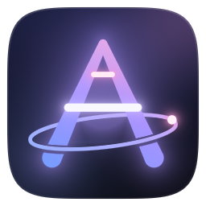

# Open Sekai Atlas

Open Sekai Atlas 是一款以社区自制谱面为主的开源下落式音游。你可以在游戏里搜索、试听并下载谱面，也可以导入自己的曲包。下载到曲库的谱面可以离线游玩。

本项目基于上游 [cubeww/OpenSekai](https://github.com/cubeww/OpenSekai) 进行大规模重构与扩展。

**当前项目版本 0.8.0** · [Android 下载](https://github.com/Whirlw/opensekai-atlas/releases) · [游玩指南](docs/guides/play-a-chart.md)

## 游戏功能

- **手动打歌与自动演示**。在手动模式挑战点按、长条、划键和摩擦键，也可以用自动模式观看整张谱面的演出。演奏中可以暂停、继续或重开。
- **结算与本地成绩**。结算显示分数、评级、最大连击和判定分布。手动完成的成绩保存在本地。
- **游戏内找谱**。添加 Sonolus 服务器后，可以浏览推荐栏目、用关键词或高级筛选找谱，在详情页试听、查看评论和排行榜，再下载、更新或直接开打。未下载的谱面可临时游玩，打完可直接保存到曲库。也可以添加网页下载站。
- **管理自己的曲库**。导入、导出或删除曲包，按标题、等级或最近修改排序，切换网格或栏目视图。曲库会记住排序、分组和视图。支持 Open Sekai 曲包（`.oskp` 或符合该曲包格式的 `.zip`），桌面编辑器中也可以导入文件夹。
- **自定义手感和画面**。调节音符流速、判定延迟、同时押线、2D MV 亮度、音乐与音效音量，选择音符皮肤、打击音与打击特效。帧率可跟随屏幕，也可设为 120、144、165、185 或 240 FPS，实际表现取决于设备。

## 开始游玩

1. 在 [GitHub Releases](https://github.com/Whirlw/opensekai-atlas/releases) 下载已发布的 APK。Android 版面向 Android 8.0（API 26）及以上的 ARM64 设备。
2. 已有曲包时，从首页打开「曲库」并选择「导入 ZIP」。想找新谱时，从首页打开「服务器」，添加你使用的 Sonolus 服务器，然后打开谱面详情下载或游玩。 [服务器使用指南](docs/guides/server-chart-downloads.md)
3. 在曲库选择「手动」或「自动」。第一次游玩时可在「设置」里调整流速和判定延迟。

## 谱面兼容性

游戏支持 Open Sekai 曲包，以及受支持的 Sonolus 谱面。NextRUSH+ 谱面由本地引擎加载，支持变速、弯曲长条、装饰引导线和伤害键。Sonolus 服务器上的谱面能否游玩取决于其引擎和使用的谱面特性。 [NextRUSH+ 兼容清单](docs/architecture/next-rush-compatibility.md) · [曲包格式](docs/architecture/chart-package.md)

## 从源码运行

用 **Unity 6000.6.7f1** 打开仓库，打开 `Assets/Game/Scenes/Library.unity` 并点击 Play。 [环境与运行](docs/getting-started/build-and-run.md) · [Android 构建](docs/operations/android-build.md) · [开发文档](docs/README.md)

## 许可

代码采用 MIT 许可证，思源黑体采用 SIL Open Font License 1.1。随项目分发的美术与音频为自制或 CC0，第三方库与资源按各自许可分发。社区曲包中的音乐、谱面和封面遵循各自的授权。 [MIT 许可证](LICENSE) · [素材来源清单](docs/operations/asset-provenance.md)
