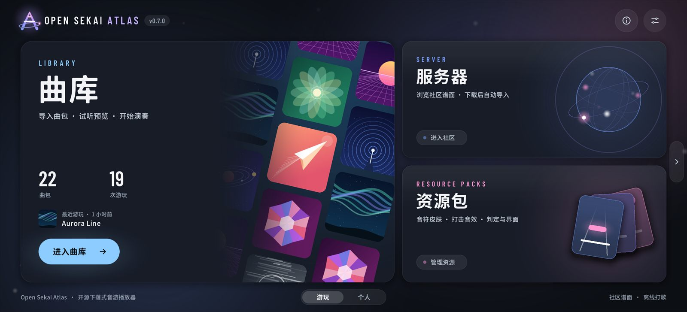
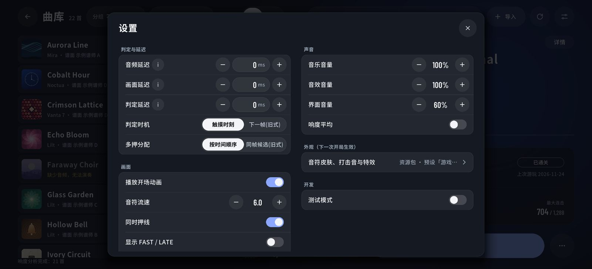
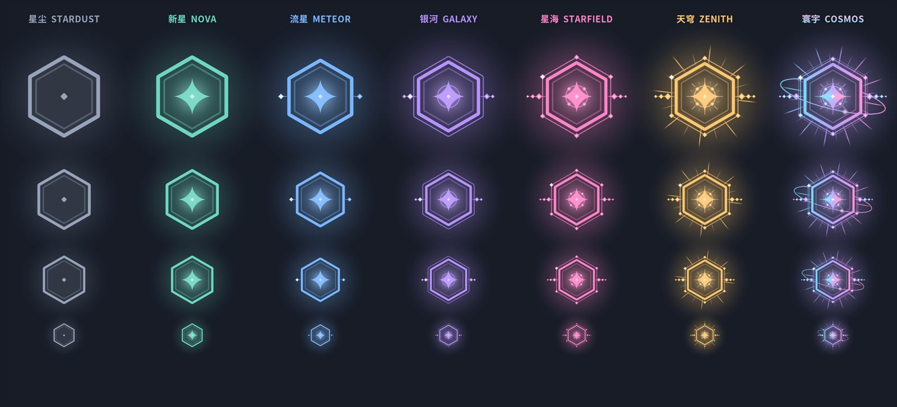
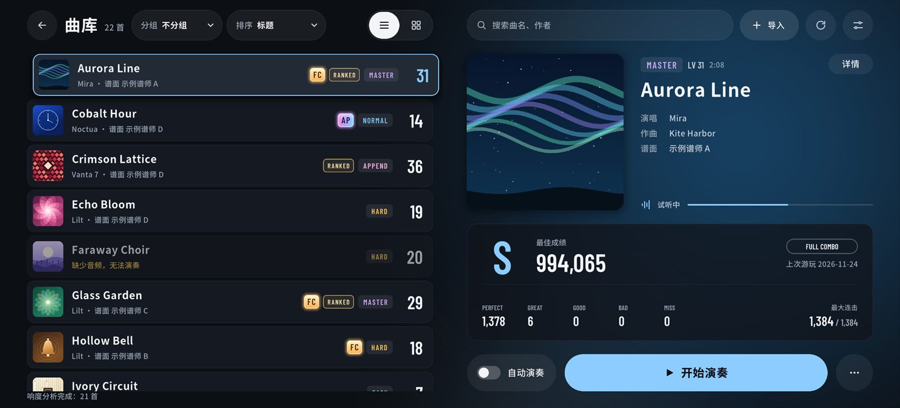
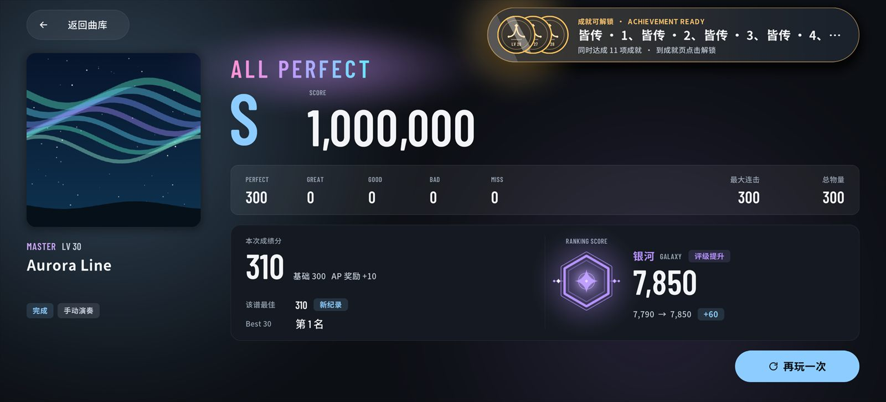
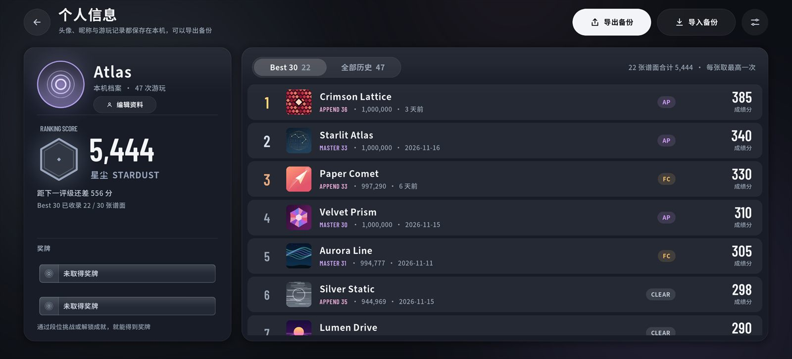

# 界面美术风格指南

> 目的：记录打歌画面以外全部界面的美术风格、数值和现成部件，写新界面时照着做就能和现有界面一致。
> 适用读者：写界面的开发者（含 AI 助手）、画界面素材的美术。
> 前置条件：能读 C#；知道界面由代码构建，见 [页面系统](../architecture/screen-system.md)。
> 最后更新：2026-11-24

## 概述

范围是开屏、首页、曲库、开局前的加载与曲目信息页、结算、服务器、资源包、个人信息、段位、成就、设置，以及它们的弹卡和提示。打歌画面、HUD 和收尾演出不在范围内；局内的暂停卡用的是同一套弹卡，按 [弹卡](#弹卡librarymodal) 做。

数值以代码为准。本文的颜色和尺寸抄自 `LibraryTheme.cs` 和 `HomeTheme.cs`，改了代码要同步改这里。没有特别说明时，路径都相对 `Assets/Game/Runtime/OpenSekai/App/UI/`，尺寸单位是 1920×1080 参考分辨率下的画布单位，颜色的百分比是不透明度。

截图中的歌曲、人名、网址和封面都是为本项目虚构和自绘的，可以放心引用。更新办法见 [截图](#截图)。

## 一分钟速览



1. **深色底，一团光**。底色 `#0C0F14`，光晕颜色跟着当前封面走。不用纯黑，不用图片背景。
2. **扁平**。纯色面、1 单位描边、柔和光晕和投影。不做金属、宝石、羽翼、木纹这类拟物效果。
3. **强调色只有一个**，取自当前封面；没有封面的页面用品牌色或白色主按钮。
4. **控件是药丸**，圆角等于高度的一半。卡片圆角 18 / 24 / 30 / 36，随层级变大。
5. **中文用思源黑体，数字和英文小标题用 Barlow Condensed**。大数字是画面的主角。
6. **层级靠明度**：Ground → Surface → SurfaceRaised，或白色叠 6% / 16%。不靠粗边框。
7. **一屏一个实心主按钮**，其余是半透明药丸；危险操作是半透明红底红字，并且要点两次。
8. **动效短而有弹性**：0.15 / 0.22 / 0.4 秒，按下缩到 0.97，选中用 `OutBack`。
9. **图标和徽章由代码画**，24 格线性图标，白色贴图染色。
10. **文案短、具体、不喊口号**。出错时说原因和下一步。

## 画布与适配

| 项 | 值 |
| --- | --- |
| Canvas | `ScreenSpaceCamera`，每个部分自带一台正交相机，同一时刻只开一台 |
| CanvasScaler | 参考 1920×1080，`MatchWidthOrHeight = 0.5` |
| 手机 2800×1272 的实际画布 | 约 2136×971 单位，高度比参考少 |
| 相机 depth | 曲库 100、首页 101、服务器 102、资源包 103、个人信息 104、段位 105、成就 106，新页面往后排 |
| 页边距 | 左右 64（`Spacing.PAGE_MARGIN`），这也是避开刘海和圆角的办法，没有另做安全区 |

竖向空间紧：设计时按高 872～1080 单位检查。弹卡用 `LibraryModal`，它会自动缩短以适应矮屏；整页布局从底部往上排，让多出来或少掉的高度落在中间的留白。

## 颜色

### 底色与面

| 名称 | 值 | 用途 |
| --- | --- | --- |
| `Ground` | `#0C0F14` | 页面底色、相机清屏色、过场幕布、系统启动画面 |
| `Surface` | `#151A22` | 曲库行、弹卡 |
| `SurfaceSelected` | `#222A36` | 选中的曲库行 |
| `SurfaceRaised` | `#1B222C` | 下拉列表、提示条 |
| `HomeTheme.Card` | `#171C27` | 首页卡片和个人 / 段位 / 成就 / 资源包的大卡 |
| `Control` | 白 6% | 一切次级控件的底：圆按钮、输入框、设置分组、列表行 |
| `ControlActive` | 白 16% | 获得焦点的输入框、关着的开关、弱选中的标签 |
| `HomeTheme.Chip` | 白 7% | 首页的标签条、卡片状态标签 |
| `Hairline` | 白 8% | 1 单位描边和分隔线 |
| `CardHighlight` | 白 6% 渐隐 | 大卡顶部 140 单位高的一层光 |
| `CoverPlaceholder` | `#252C38` | 没有封面时的底 |
| `Scrim` | `#06080C` 77% | 弹卡后面的遮罩 |

曲库右侧的成绩卡和谱面详情页的内容卡要透出背景光晕，用 `#10141B` 72%。

### 文字

| 名称 | 值 | 用途 |
| --- | --- | --- |
| `TextPrimary` | `#F2F4F7` | 标题、数值、按钮文字；也是白色主按钮的底 |
| `TextSecondary` | `#C5CEDA` | 次要正文、图标 |
| `TextMuted` | `#9AA6B5` | 说明、小标题、占位文字 |
| `TextOnAccent` | `#0C0F14` | 强调色或白色按钮上的文字 |

不要再造灰阶。禁用态用 `CanvasGroup.alpha = 0.38`，不可玩的曲目整行 0.6。

### 状态

| 名称 | 值 | 用途 |
| --- | --- | --- |
| `Warning` | `#F5C451` | 缺少音频等不致命的问题 |
| `Danger` / `DangerSurface` | `#F58080` / 同色 14% | 删除、失败、错误原因 |
| 成功 | `#7BD88F` | 已下载、剩余生命充足（`DanCopy.Life`） |
| 通过 | `#FFCE78` | 段位通过（`DanCopy.Pass`） |

### 强调色与光晕

`JacketPalette.From` 从封面取一个主色相，鲜艳的像素权重更大：

- **Accent**：同色相，饱和度夹到 0.28～0.45，明度 1。用于选中描边、等级数字、进度、主按钮底。
- **Glow**：同色相，饱和度 ×1.2 夹到 0.45～0.8，明度 0.55。用于背景光晕。
- 饱和度低于 0.08 的封面用中性色 `#C4CCD8` / `#343A44`。没有封面时用默认 `#9DB8FF` / `#25345C`。

页面背景是两团 `LibraryShapes.Glow()`：主光 1900×1900，中心在右上角内 (380, 340)，62%；副光 1100～1200，在底边，强调色 8%～10%。换封面时用 0.4 秒过渡。同一套规则在 `MusicInfoView` 里有一份，改的时候一起改。

### 品牌色

| 名称 | 值 | 用在 |
| --- | --- | --- |
| `Periwinkle` | `#789CFF` | 服务器、音效 |
| `Violet` | `#AC92FF` | 段位、打击特效、首页提示条 |
| `Rose` | `#FF96D2` | 资源包（该部分的强调色）、音符皮肤 |
| `Gold` | `#FFC670` | 成就 |
| 字标强调 | `#C2AEFF` | 字标里的 ATLAS |

新增的部分先从这四个里挑；挑不到再按相近的明度和饱和度加一个。

### 内容语义色

| 组 | 颜色 |
| --- | --- |
| 难度 | EASY `#7BD88F` · NORMAL `#7CC8F5` · HARD `#F5C451` · EXPERT `#F59A9A` · MASTER `#CDA6F5` · APPEND `#F2B0DE`（`Colors.Difficulty`） |
| ALL PERFECT | 粉 `#FF92D6` → 紫 `#BA9EFF` → 青 `#70E0FF`（`AllPerfectStops`），字 `#24123A` |
| FULL COMBO | 上 `#FFEEB0` → 下 `#FFB054`，字 `#4A2604` |
| Ranked | 上 `#FFF7DE` → 下 `#FFD27A` |
| 评级 | 星尘 `#96A3BA` · 新星 `#6ED6C0` · 流星 `#7AB6FF` · 银河 `#B692FF` · 星海 `#FF84C8` · 天穹 `#FFC670` · 寰宇 ALL PERFECT 棱镜（`RankingTiers`） |
| 判定（段位） | PERFECT `#FFCE78` · GREAT `#FF8CBA` · GOOD `#7AB6FF` · BAD `#7BD88F` · MISS `#9AA6B5`（`DanCopy.JudgeColors`） |
| 名次 | 金 `#FFD678` · 银 `#D6DEEB` · 铜 `#E8AA80` |

彩色小标签的写法是**同色字 + 同色 13% 底**（`PackWidgets.Tag`）；需要强调时反过来，实心底配深色字。

## 文字

| 角色 | 字体 | 字号 | 例子 |
| --- | --- | --- | --- |
| 首页大标题 | 思源黑体 Bold | 96（大卡）/ 54（小卡） | 曲库、服务器 |
| 详情标题 | Bold | 46（`DETAIL_TITLE`） | 曲名，最多两行 |
| 页标题 | Bold | 40（`PAGE_TITLE`） | 顶栏 |
| 弹卡标题 | Bold | 34 | 谱面详情 |
| 行标题 | Bold | 26（`ROW_TITLE`） | 曲库行 |
| 正文 / 控件 | Medium | 20～24（`BODY` = 20） | 按钮、设置项 |
| 说明 | Medium | 16～18（`CAPTION` = 18） | 小标题、单位 |
| 眉题 | Barlow Condensed，字距 18～30 | 20～24 | LIBRARY、RANKING SCORE |
| 难度、RANKED、判定名 | Barlow Condensed，字距 1.5～6 | 14～22 | MASTER、PERFECT |
| 大数字 | Barlow Condensed | 30～66；首页 Ranking Score 112，结算分数 124、评级字母 176 | 994,065 |

- 创建文字一律用 `LibraryWidgets.Label`（单行、省略号）或 `LibraryUi.CreateText`（可换行）。外部来的文字（曲名、昵称、服务器文本）用 `PackWidgets.UserLabel` 或关掉 `richText`。
- 窄体用 `LibraryUi.UseCondensedFont`；带字距用 `UseSpacedCondensedFont`。**不要直接改 `characterSpacing`**，会触发 C# 检查，原因见 [字体](fonts.md#运行时-ui-的字距)。
- 眉题用全大写英文，颜色是该部分的色；中文标题永远是白色。
- 数字用千分位，`ToString("N0", InvariantCulture)`；没有值写 `—`。
- 字号按上表取，别用介于两档之间的新值。

## 间距、圆角与尺寸

| 类 | 值 |
| --- | --- |
| 间距 | 4 / 8 / 16 / 24 / 32，页边 64 |
| 圆角 | 标签 8（`CHIP`）· 小封面 12 · 行与设置分组 18（`ROW`）· 弹卡、大封面、成绩卡 24（`PANEL`）· 内容大卡 30 · 首页主卡 36 · 药丸 = 高度 ÷ 2 |
| 按钮高 | 88 页面主按钮 · 76 弹卡按钮 · 72 顶栏 · 52～64 行内 · 46～48 最小 |
| 行高 | 曲库 100 · 设置 72 · 历史 96 · 段位 112 · 资源包 116 · 成就 172 |
| 封面 | 行内 72 · 弹卡 64 · 加载 300 · 详情 380～440 |
| 大卡内边距 | 首页 44 / 56 · 内容卡 32～36 · 弹卡 40 |
| 最小触控 | 44 |

## 形状、投影与图标

全部由 `LibraryShapes` / `HomeShapes` 在运行时生成白色贴图再染色，以 2 倍画布尺寸绘制，圆角形状是九宫格。**新界面不导入 PNG 切图。**

| 要什么 | 用什么 |
| --- | --- |
| 实心圆角 | `LibraryWidgets.Panel(name, parent, radius, color)` |
| 1 单位描边 | `LibraryWidgets.Outline(panel, radius)`；其他粗细用 `LibraryShapes.Ring` |
| 投影 | `LibraryWidgets.Shadow(rect, radius, blur, drop, opacity)` |
| 光晕 | `LibraryShapes.Glow()`，放大并降低不透明度 |
| 横幅（两端渐隐） | `LibraryShapes.Band()`；大面积半透明用 `DitheredBand` 防色带 |
| 渐隐 | `HomeShapes.FadeUp`（上实下虚）、`FadeDown`（下实上虚）、`FadeRight`（左实右虚） |
| 六边形、箭头 | `LibraryShapes.Hexagon / Chevron` |
| 图标 | `LibraryWidgets.Icon(parent, LibraryIcon.X, color, size)` |

投影三档：封面和大卡 28 模糊 / 下移 4 / 25%（`CoverShadow`）；选中的行 24 / 8 / 39%；弹卡 56 / 18 / 67%。

图标在 24×24 的格子里画，线宽约 2.1，圆头，无填充（爱心、锁、播放除外）。按钮里图标约为按钮高的 0.36～0.42。现有 30 个，见 `LibraryIcon`；要加就在 `LibraryShapes.IconDistance` 里用线段和圆拼，不从图标库下载。

大面积的深色渐变要加抖动，贴图不压缩，否则手机上会出色带。

## 部件

新界面先从这里拿，拿不到再写新的，并放进对应的 `*Widgets`。

| 部件 | 入口 | 要点 | 近照 |
| --- | --- | --- | --- |
| 顶栏 | `ServerWidgets.TopBar` | 高 120；左：返回圆钮 72、标题、副标题；右：从右往左排设置和页面按钮 | [图](../images/ui-style/part-topbar.jpg) |
| 圆图标钮 | `ServerWidgets.IconButton`、`PackWidgets.SmallIconButton` | `Control` 底 + 描边，图标 `TextSecondary` | 同上 |
| 主 / 次按钮 | `LibraryWidgets.PillButton`、`ServerWidgets.LabelledButton`（带图标） | 见 [按钮配色](#按钮配色) | [图](../images/ui-style/part-buttons.jpg) |
| 输入框 | `LibraryWidgets.TextField`、`DanWidgets.NumberField / MultiLineField` | 药丸 + 描边；获得焦点变 `ControlActive`；出错 `DanWidgets.SetFieldError` 把描边变红 | [图](../images/ui-style/server-add.jpg) |
| 下拉 | `LibraryDropdown.Create`；动作菜单 `AttachActions` | 列表圆角 20、选项高 52，当前项强调色加对勾，点空白处关闭 | [图](../images/ui-style/part-dropdown.jpg) |
| 分段（强选中） | `LibrarySettingRows.AddSegmented`、曲库的列表 / 网格切换 | 白底深字滑块 | [图](../images/ui-style/part-tabs.jpg) |
| 页签（弱选中） | `HomePageTabs` | `ControlActive` 滑块、白字，随手势连续移动 | [图](../images/ui-style/profile-best30.jpg) |
| 分组标签条 | `LibraryGroupBar` | 高 48，横向滚动，选中白底深字，后跟数量 | [图](../images/ui-style/library-grouped.jpg) |
| 设置分组 | `LibrarySettingRows`：开关、步进、毫秒、分段、下拉、链接、文本、数值、多选 | 灰色小标题 + 圆角 18 的组，行高 72，行间细线 | [图](../images/ui-style/part-settings.jpg) |
| 曲目行 / 格 | `LibraryRowCell`、`LibraryTileCell`、`SonolusLevelTile` | 虚拟列表 `VirtualListView`，滚动中不做入场动画 | [行](../images/ui-style/part-rows.jpg) · [格](../images/ui-style/part-tiles.jpg) |
| 内容大卡 | `HomeCardFrame`；各页的 `Card()` | 圆角 30，`HomeTheme.Card`，顶部一层光，描边画在最上层 | [图](../images/ui-style/home.jpg) |
| 标签 | `ServerWidgets.Chip`、`PackWidgets.Tag` | 宽度跟文字；外部文本会很长时由调用方截断 | [图](../images/ui-style/part-chips.jpg) |
| 成绩标记 | `LibraryAwardBadge`、`LibraryRankedTag` | 只在 FC / AP / Ranked 时出现 | [图](../images/ui-style/part-rows.jpg) |
| 操作行 | `LibraryActionRow` | 高 104，圆底图标 + 标题 + 一行说明 + 箭头，支持两次确认 | [图](../images/ui-style/part-armed.jpg) |
| 提示条 | `UiToast` | 底部药丸，高 64，停 2.2 秒 | [代码](../../Assets/Game/Runtime/OpenSekai/App/UI/UiToast.cs) |
| 就地提示 | `LibraryDetailPanel.ShowHint` | 按钮旁的小药丸，解释为什么点不了 | [图](../images/ui-style/part-hint.jpg) |
| 加载 / 空 / 失败 | `ServerStatusView` | 居中一行字；加载时呼吸，失败时给「重试」 | [空列表](../images/ui-style/server-empty.jpg) |
| 滚动区 | `ServerWidgets.VerticalList`、`PackWidgets.Scroll` | 弹性 0.12，减速 0.135；加透明底图让空白处也能拖 | — |

### 按钮配色

| 角色 | 底 | 字 | 用在 |
| --- | --- | --- | --- |
| 主按钮（有封面） | 封面强调色 | `TextOnAccent` Bold | 开始演奏、游玩、再玩一次 |
| 主按钮（无封面） | `TextPrimary` | `TextOnAccent` Bold | 添加服务器、保存、开始挑战、导出备份 |
| 次按钮 | `Control` + 描边 | `TextPrimary` | 取消、下载、试听 |
| 危险 | `DangerSurface` | `Danger` | 删除、卸载、清空 |
| 不可用 | `Control` | `TextSecondary`，文字直接写原因 | 无法演奏 · 缺少音频文件 |
| 可点但被拦 | 白 3% | `TextMuted` 55% | 点了用就地提示说明原因 |

一块区域只放一个实心按钮，放在右下角。弹卡里「取消」在左、主按钮在右。

### 选中态

| 对象 | 选中时 |
| --- | --- |
| 列表行 | 底 `SurfaceSelected`，2 单位强调色描边，投影，右移 14 |
| 网格 | 封面外 4 单位强调色环，放大 1.02，标题变强调色 |
| 竖排卡片（资源包、段位） | 描边和底染该项的颜色，右上角一个实心小标签（使用中、佩戴中） |
| 下拉选项 | 强调色文字 + 对勾 |

## 页面骨架

### 整页

1. 相机、Canvas、底色、两团光晕（见 `ServerScreen.Build`）。
2. `PageHost`：一页一个 `CanvasGroup`，推入时滑动。
3. `ModalLayer`：弹卡。4. `Overlay`：下拉列表。5. `UiToast`。6. 幕布。

顶栏占 120，正文从 128 开始，左右各让 64，底部让 40～76。

### 三种布局

| 布局 | 比例 | 用在 |
| --- | --- | --- |
| 列表 + 详情 | 左 48%，右从 52% 开始 | 曲库 |
| 资料卡 + 列表 | 左固定 560～640，间距 28，右侧占满 | 个人信息、段位、成就、资源包（600 / 32） |
| 封面 + 内容 | 左封面 420～440，间距 56～72，右侧堆叠 | 结算、谱面详情 |

左边放「是谁 / 选了什么」，右边放「内容和操作」。主操作总在右下。

### 弹卡（`LibraryModal`）



- 标题区高 112，内边距 40，右上角 64 的关闭圆钮；点遮罩等于关闭。不能随手关掉的（导入中、准备挑战）传 `onClose: null`。
- 常用尺寸：确认 / 操作 780×380～492 · 单列内容 940～1120 宽 · 双列表单 1240×860～900 · 设置 1360×880 · 编辑器与大预览 1500～1640 宽。
- 内容高度不定时用 `FitToBody`。按钮高 76，贴弹卡底边。
- 打开：遮罩和卡片 0.22 秒淡入，卡片从 0.96 弹到 1。关闭是立即的，这样连续换卡不会重叠。

### 列表的四种状态

加载、空、失败、有内容都要做。空状态要给出下一步：一句话加一个按钮（[服务器空列表](../images/ui-style/server-empty.jpg)），或至少说明为什么空（[搜索无结果](../images/ui-style/library-empty.jpg)）。

## 动效

| 名称 | 秒 | 缓动 | 用在 |
| --- | --- | --- | --- |
| `FAST` | 0.15 | `OutCubic` / `OutQuad` | 按下、下拉展开 |
| `STANDARD` | 0.22 | `OutCubic`，选中用 `OutBack` | 弹卡、选中、开关、幕布落下（`InCubic`） |
| `SLOW` | 0.4 | `OutQuad` | 光晕换色、幕布升起 |
| 推页 | 0.28 | `OutCubic` | 新页从 64 单位外滑入并淡入，旧页反向移 32 并淡出 |
| 卡片展开 / 收回 | 0.46 / 0.55 | 见 `HomeView` | 首页卡片长成整页、缩回原位 |
| 首页翻页 | 0.42 | `OutCubic` | 跟手，划过 18% 或快速一拨就翻 |
| 卡片入场 | 0.62，错开 0.07 | `OutCubic` | 上升 56 单位 |
| 列表入场 | 0.22，错开 0.025 | 淡入上移 14 | 只在列表第一次出现时，最多 16 项 |
| 数字滚动 | 0.5～0.9 | `OutCubic` | 分数、统计 |

- **按下**：按钮缩到 0.97，大卡和行 0.985，小卡 0.975；松手用 `OutBack` 弹回。挂 `LibraryPressFeedback`，按钮的 `transition` 一律 `None`。
- **警告抖动**：危险行第一次点击左右转 1.6°，0.36 秒；未开放的首页卡横向抖 14 单位。
- **切换部分**：卡片放大铺满并过渡到 `Ground`，目标页从同色幕布里升起；返回时反过来。两页之间永远隔着一块纯 `Ground`。[中途一帧](../images/ui-style/home-handoff.jpg)
- **待机动画**要轻：光点、地球仪、卡扇、徽章上下浮动 8 单位。放进自己的子 Canvas，避免整页重批。
- 较长的演出（开屏、结算、段位认定、成就解锁）写成**时间的纯函数**，用一条 LitMotion 推进。点屏幕跳到结尾，截图工具能停在任意帧。
- 首页和服务器、资源包、个人、段位、成就都用 `HomeMotion.Scheduler`（不受 `timeScale` 影响，截图时可换成手动时钟），新页面也用它。持有的 `MotionHandle` 在重播、隐藏和销毁时取消，见 [动画入口规范](../coding-standards/11-animation.md)。

## 音效

每个可点的东西都要有声音，从 `UiCue` 里选，不加新音频。

| 动作 | `UiCue` |
| --- | --- |
| 普通按钮 | `Press` |
| 选中一项、切标签 | `Select` |
| 开关 | `ToggleOn` / `ToggleOff` |
| 下拉 | `Expand` / `Collapse` |
| 弹卡 | `Open` / `Close` |
| 前进 / 返回 | `Forward` / `Back` |
| 开局 / 再来 / 取消 | `Start` / `Retry` / `Cancel` |
| 危险操作：第一次 / 执行 | `Warning` / `Delete` |
| 结果 | `Success` / `Error` / `Achievement` |
| 点了但不行、到头了 | `Blocked` |

声音由处理函数自己决定时，按钮的 `sound` 传 `UiCue.None`，避免响两次。

## 文案

- 按钮 2～4 个字，动词开头：导入、下载、再次挑战。进行中加省略号：正在加载…、刷新中…。
- 标题说是什么，副标题说一句用处或状态。并列信息用 ` · ` 隔开，变化用 ` → `，减号用 `−`。
- 出错写原因和下一步，不道歉、不用感叹号：「无法连接服务器，请检查网络」。
- 危险操作两步：第一行变成「再点一次确认删除」，第二行「此操作无法撤销」。
- 引用界面上的名字用「」。中文和英文、数字之间留空格。
- 时间一周内写相对时间（刚刚、3 小时前、2 天前），更早写 `2026-11-18`。
- 英文只用在眉题、判定、难度、评级和专有名词（Best 30、Ranking Score）。
- 一个部分的文案集中放在 `*Copy.cs`（`ResultCopy`、`DanCopy`、`ProfileCopy`、`AchievementCopy`）。

## 插画与徽章



共同的语言：**几何形 + 染色面 + 实线 + 菱形 + 光点**。画法都是纯数学（有向距离场或三角网格），不依赖 Unity 类型，能在后台线程画、能测试。

| 东西 | 代码 | 规则 |
| --- | --- | --- |
| 品牌标 | `Home/BrandArt.cs` | 「A」是透视轨道，横杠是判定线，环是轨道。不改比例，不加字 |
| 首页插画 | `Home/HomeCards.cs`、`HomePlayerCards.cs` | 只用现成形状拼：地球仪、卡扇、段位牌、奖牌。右侧 280×280 |
| 评级徽章 | `Result/RankingCrestArt.cs` | 六边形。高一级保留低一级的全部元素再加一层 |
| 奖牌 | `Medals/MedalArt.cs` | 长方形，和评级区分开。初阶 → 进阶 → 高阶 → 星阶 → 虹阶逐级加框线和菱形，虹阶走棱镜色 |
| 特殊奖牌 | `Medals/SpecialPlateArt.cs` | 整块单独画，会动 |
| 奖牌图案、头像 | `Medals/MedalEmblemArt.cs`、`Profile/AvatarArt.cs` | 扁平，主色加同色浅调，白色只留给「亮着」的那一处 |

新增或升级一档时：从现有那一档长出来，保持比例和配色，先出一张离线对照图再接进游戏。走过的弯路：斜面金属、宝石、翅膀都因为像另一个产品被否了。

奖牌面的算法：面 = `Card` 向主色混 26%，左侧色带 27%，描边 75%；未取得时主色向 `TextMuted` 混 75%。头像：底 = `Surface` 向主色混 16%，从上往下一层 36% 的主色渐隐，描边 82%。

对照图：[奖牌各阶](../images/ui-style/medal-tiers.jpg) · [普通系列](../images/ui-style/medal-series.jpg) · [特殊奖牌](../images/ui-style/medal-special.jpg) · [头像](../images/ui-style/avatars.jpg) · [评级升级动画](../images/ui-style/ranking-upgrade.jpg)

## 各界面

正文只放主要画面，其余点链接看。

### 开屏与首页

开屏：音符落到判定线，轨道收拢成品牌标，字标淡入，标飞进首页左上角。时间线见 [首页、开屏与品牌标](../architecture/home-and-brand.md)。[落下](../images/ui-style/splash-fall.jpg) · [命中](../images/ui-style/splash-hit.jpg) · [字标](../images/ui-style/splash-wordmark.jpg)

首页两页，每页一张主卡（占宽 58.5%）加右侧上下两张小卡，间距 24。卡片的固定结构：英文眉题（部分色）→ 大标题 → 一句说明 → 底部状态；右侧是插画。主卡文字压在一块实心底上，向右渐隐进插画。背景是三团缓慢漂移的品牌色极光加上升的光点。[第二页](../images/ui-style/home-player.jpg) · [滑动中](../images/ui-style/home-swipe.jpg) · [关于](../images/ui-style/about.jpg)

### 曲库



左边列表，右边详情：封面与曲目信息、最佳成绩、操作行。整页的强调色和光晕跟着选中的封面变。行内从右到左固定为等级、难度、RANKED、FC/AP；网格里四个角各放一种：左上 RANKED、左下 FC/AP、右下难度与等级、右上缺失提示。

[网格](../images/ui-style/library-grid.jpg) · [分组](../images/ui-style/library-grouped.jpg) · [另一种封面色](../images/ui-style/library-accent.jpg) · [缺音频](../images/ui-style/library-missing.jpg) · [无结果](../images/ui-style/library-empty.jpg) · [成绩卡](../images/ui-style/part-record.jpg) · [谱面详情 Ranked](../images/ui-style/library-details-ranked.jpg) / [Unranked](../images/ui-style/library-details-unranked.jpg) · [规则长文](../images/ui-style/library-rules.jpg) · [操作卡](../images/ui-style/actions.jpg) · [二次确认](../images/ui-style/part-armed.jpg) · [设置](../images/ui-style/settings.jpg) · [设置子页](../images/ui-style/settings-trace.jpg)

### 加载与曲目信息页

加载页居中：封面 300、曲名、当前步骤、不定进度条、取消。它也是进入打歌的幕布。曲目信息页（`MusicInfoView`）用同一套底色、取色和难度标签，但布局在 `FrontUIView.prefab`，由菜单 `OpenSekai/Art/Rebuild Music Info Page` 生成，不要手改 prefab。[加载](../images/ui-style/loading.jpg) · [曲目信息](../images/ui-style/music-info.jpg)

### 结算



左封面右内容：奖项大字（FC 金色、AP 棱镜色并带光晕）→ 评级字母和分数 → 判定条 → 成绩分与 Ranking Score 卡 → 右下「再玩一次」。开场约 2.5 秒（升级时约 3.3 秒），点屏幕跳过。

[普通](../images/ui-style/result.jpg) · [FULL COMBO](../images/ui-style/result-full-combo.jpg) · [失败](../images/ui-style/result-failed.jpg) · [自动](../images/ui-style/result-auto.jpg) · [成绩未保存](../images/ui-style/result-save-failed.jpg) · [没能开局](../images/ui-style/result-load-error.jpg)

### 服务器

列表是三列卡片（高 312）；Sonolus 首页是横向封面行，全部谱面是网格，详情页与结算同一种布局，多三个标签页。服务器给的文字一律当纯文本。[空列表](../images/ui-style/server-empty.jpg) · [列表](../images/ui-style/server-list.jpg) · [添加](../images/ui-style/server-add.jpg) · [栏目](../images/ui-style/server-sections.jpg) · [全部](../images/ui-style/server-all.jpg) · [高级搜索](../images/ui-style/server-search.jpg) · [详情](../images/ui-style/server-level.jpg) · [社区](../images/ui-style/server-level-community.jpg) · [排行榜](../images/ui-style/server-level-leaderboard.jpg)

网页服务器的顶栏是 Android 原生界面（`ChartBrowserActivity.java`），颜色和本文一致，改色时一起改。

### 资源包

部分色是 Rose。左边方案卡和列表，右边实时演示。[总览](../images/ui-style/packs-overview.jpg) · [详情](../images/ui-style/packs-detail.jpg) · [预览](../images/ui-style/packs-preview.jpg) · [类别](../images/ui-style/packs-category.jpg)

### 个人信息



左资料卡：头像、昵称、Ranking Score 与评级、佩戴的奖牌。右边列表，前三名用金银铜色。[历史](../images/ui-style/profile-history.jpg) · [编辑资料](../images/ui-style/profile-edit.jpg) · [合并预览](../images/ui-style/profile-import.jpg) · [选择奖牌](../images/ui-style/profile-medals.jpg) · [评级徽章](../images/ui-style/ranking-gallery.jpg)

### 段位

左段位列表，右详情；右侧的光和描边用该段位牌的颜色。[段位](../images/ui-style/dan.jpg) · [编辑](../images/ui-style/dan-editor.jpg) · [选择等级](../images/ui-style/dan-grades.jpg) · [粘贴](../images/ui-style/dan-paste.jpg) / [出错](../images/ui-style/dan-paste-error.jpg) · [删除确认](../images/ui-style/dan-delete.jpg) · [准备](../images/ui-style/dan-prepare.jpg) · [曲间休息](../images/ui-style/dan-rest.jpg) · [通过](../images/ui-style/dan-result-pass.jpg) · [认定演出](../images/ui-style/dan-award.jpg) · [未通过](../images/ui-style/dan-result-fail.jpg)

### 成就

左进度环与统计，右列表。可解锁的行呼吸发光、描边染该成就的颜色；未达成的用进度条。[全部](../images/ui-style/achievements.jpg) · [特殊](../images/ui-style/achievements-special.jpg) · [奖励卡](../images/ui-style/achievements-reward.jpg) · [解锁动画](../images/ui-style/achievements-claim.jpg) · [顶部提示卡](../images/ui-style/achievements-popup.jpg)

## 写一个新界面

1. **先定位**：它是新的一页、一张弹卡，还是现有页的一块？能做成弹卡就不要开新页。
2. **找最像的现有界面**照着排，看上面的链接和源码。
3. **用部件和主题常量**，不写字面颜色和字号。确实要新增颜色、尺寸，加进 `LibraryTheme` / `HomeTheme` 再用。
4. **补全状态**：加载、空、失败、禁用、长文本、无封面、数值为 0。
5. **加动效和声音**，处理返回键（先关下拉，再关弹卡，再退页）。
6. **截图检查** 2800×1272 和 1920×1080，加进截图工具（`ScreenshotDriver`），更新本文。

一张确认卡的最小写法：

```csharp
internal sealed class ExamplePanel : IDisposable
{
    private readonly LibraryModal _modal;

    internal ExamplePanel(RectTransform modalLayer, Action onConfirm)
    {
        RectTransform root = LibraryUi.CreateRect("ExamplePanel", modalLayer);
        LibraryUi.Stretch(root);
        _modal = new LibraryModal(root, new Vector2(780f, 380f), "标题", Close, withSubtitle: true);
        _modal.Subtitle.text = "一句说明";

        TextMeshProUGUI body = PackWidgets.Paragraph(
            _modal.Body, "Text", "正文", 22f, LibraryTheme.Colors.TextSecondary);
        float height = LibraryTheme.Layout.MODAL_BUTTON_HEIGHT;
        LibraryWidgets.Inset(body.rectTransform, 0f, height + LibraryTheme.Spacing.L, 0f, 0f);

        Button confirm = ServerWidgets.LabelledButton(
            _modal.Body, "Confirm", "确定", LibraryIcon.Check, () => onConfirm?.Invoke(), 200f, height,
            LibraryTheme.Colors.TextPrimary, LibraryTheme.Colors.TextOnAccent, UiCue.Success);
        LibraryWidgets.Place((RectTransform)confirm.transform, Vector2.right, Vector2.right, Vector2.zero, new Vector2(200f, height));

        Button cancel = LibraryWidgets.PillButton(
            "Cancel", _modal.Body, "取消", Close, 180f, height,
            LibraryTheme.Colors.Control, LibraryTheme.Colors.TextPrimary, sound: UiCue.Cancel);
        LibraryWidgets.Outline((Image)cancel.targetGraphic, height * 0.5f);
        LibraryWidgets.Place((RectTransform)cancel.transform, Vector2.right, Vector2.right,
            new Vector2(-200f - LibraryTheme.Spacing.M, 0f), new Vector2(180f, height));
        root.gameObject.SetActive(false);
    }

    internal void Show() => _modal.Open();

    private void Close() => _modal.Close();

    public void Dispose() => _modal.Dispose();
}
```

新的一页从 `AchievementScreen` / `AchievementView` 抄起：一个管相机、Canvas、幕布和返回键，一个管布局。新的一个部分还要在 `HomeScreen` 接入卡片展开和收回。

### 自查

- [ ] 没有字面颜色、没有 PNG 切图、没有直接设 `characterSpacing`
- [ ] 一块区域只有一个实心按钮，危险操作要点两次
- [ ] 外部文本关了富文本，超长会省略
- [ ] 每个可点的东西有按下反馈和声音，触控区不小于 44
- [ ] 返回键、点遮罩、切后台都处理了，`MotionHandle` 都会取消
- [ ] 画布高 872 时没有重叠
- [ ] 截图里没有第三方封面

## 已知的不一致

照抄旧代码前先看这里；新界面按「应当」一列做。

| 现状 | 应当 |
| --- | --- |
| 曲库顶栏的返回、刷新、设置圆钮没有描边，其余页面的圆钮有；`AddSettingsButton` 在所有页面都没有 | 用 `ServerWidgets.IconButton`，带描边 |
| 14、15、16、17、19、21、22、24、25 等字号散落在各处，没有常量 | 取「文字」一节的档位 |
| 成功绿 `#7BD88F`、名次金、成绩卡底色 `#10141B` 72% 各处重复写字面值 | 先提进主题再用 |
| 个人历史的 AP / FC 标签用自己的一对颜色（`ProfileCopy`） | 用 `AllPerfectStops` / `FullCombo*` 同色系 |
| 内容大卡的圆角 30 在 `ProfileView`、`DanView`、`AchievementView` 里各有一份常量，`Card()` 也各写了一遍；资源包的演示卡和类别卡用 26 | 新页面用 `HomeTheme.Layout.CARD_RADIUS`，能用 `HomeCardFrame` 就用 |
| 取色和难度色在 `MusicInfoView` 有第二份（程序集隔离） | 改一处要同步另一处 |

## 截图

`docs/images/ui-style/` 里的图全部来自示例工作区：歌曲、作者、网址是虚构的，封面由 `ArtSource/Tools/SampleCovers/render_covers.js` 画出，服务器画面由编辑器内的示例服务器应答，不联网。**不要用自己的曲库或线上服务器截图替换**，那里有第三方封面。

更新步骤：

```powershell
powershell -File Tools/new-sample-workspace.ps1
```

在 Unity 里打开新工作区一次，等导入完成，然后在该目录里：

```powershell
powershell -File Tools/capture-screens.ps1 -StyleGuide -OutDir TestResults/screenshots/style-guide
```

```powershell
powershell -File Tools/export-style-guide-images.ps1 -Source TestResults/screenshots/style-guide
```

把 `docs/images/ui-style/` 拷回主工作区提交。参数和示例内容的细节见 [截图工具](../operations/screenshot-tools.md#示例工作区)，录宣传片也用这个工作区。

## 相关文档

- [首页、开屏与品牌标](../architecture/home-and-brand.md) · [服务器页面](../architecture/server-screen.md) · [资源包页面](../architecture/resource-pack-screen.md)
- [页面系统](../architecture/screen-system.md) · [动画入口规范](../coding-standards/11-animation.md) · [字体](fonts.md)
- [截图工具](../operations/screenshot-tools.md) · [素材来源清单](../operations/asset-provenance.md)
